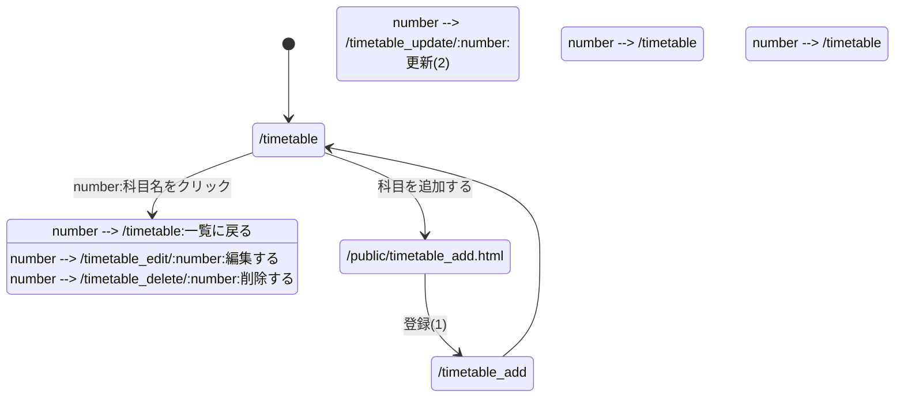
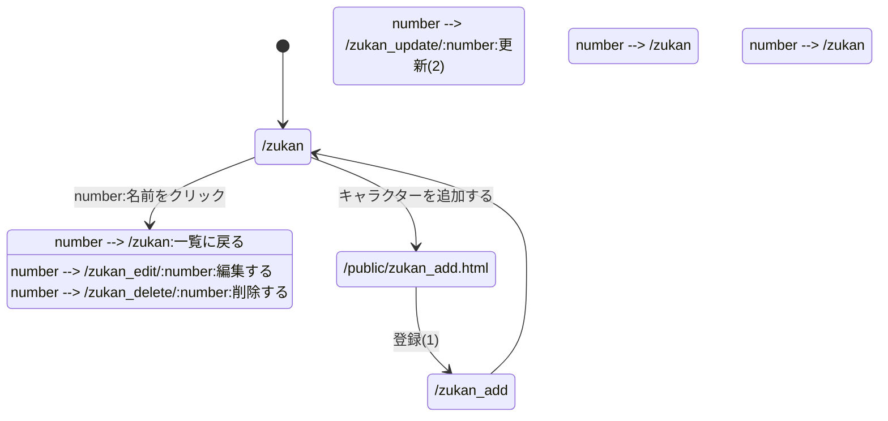

# レポート用システムの設計

一覧表示をベースとしたWebアプリケーションを，京葉線システム以外に3つ開発する．

| No. | システム名 | 対象 | 一覧のURL |
|-|-|-|-|
| 1 | 時間割・履修科目管理システム | 自分が履修している科目 | /timetable |
| 2 | キャラクター図鑑システム | ゲームのキャラクター（ポケモンなど） | /zukan |
| 3 | 好きな店管理システム | 自分が行ったラーメン屋などの飲食店 | /shop |

### 共通の方針
- データは変数（配列）内に記録する（DBは使わない）
- 一覧・詳細表示，追加，削除，変更を実装する
- JSファイルの先頭に `"use strict";` を付ける
- 一覧画面では主な項目だけを表示し，名前をクリックすると詳細画面に移動する
- 数値の項目は，受け取った後に `Number()` で数値に変換する
- 削除・変更のURLは仮のもの．REST APIの説明（次回以降）を受けて見直す

---

## 1. 時間割・履修科目管理システム

### 対象
自分が履修している科目を登録して，曜日・時限・教室などをすぐ確認できるようにする．

### ページ遷移図

### スキーマ

項目名 | 型 | 内容
-|-|-
id | 数値 | 科目ID
name | 文字列 | 科目名
teacher | 文字列 | 担当教員名
day | 文字列 | 曜日（月〜金）
period | 数値 | 時限（1〜5）
credit | 数値 | 単位数
room | 文字列 | 教室

### 一覧画面に表示する項目
曜日，時限，科目名

### (1)(2)のパラメータ

パラメータ名 | 属性 | 内容 | 値
-|-|-|-
id | number | 科目ID | 例：1
name | text | 科目名 | 例：Webプログラミング
teacher | text | 担当教員名 | 例：千葉太郎
day | text | 曜日 | 月/火/水/木/金
period | number | 時限 | 1〜5
credit | number | 単位数 | 例：2
room | text | 教室 | 例：7号館 7301

---

## 2. キャラクター図鑑システム

### 対象
ゲームのキャラクター（ポケモンなど）の名前・タイプ・能力値を登録して，図鑑として見られるようにする．

### ページ遷移図

### スキーマ

項目名 | 型 | 内容
-|-|-
id | 数値 | 図鑑番号
name | 文字列 | 名前
type | 文字列 | タイプ（例：ほのお，みず）
hp | 数値 | HP
attack | 数値 | こうげき
defense | 数値 | ぼうぎょ
description | 文字列 | 説明文

### 一覧画面に表示する項目
図鑑番号，名前，タイプ

### (1)(2)のパラメータ

パラメータ名 | 属性 | 内容 | 値
-|-|-|-
id | number | 図鑑番号 | 例：25
name | text | 名前 | 例：ピカチュウ
type | text | タイプ | 例：でんき
hp | number | HP | 例：35
attack | number | こうげき | 例：55
defense | number | ぼうぎょ | 例：40
description | text | 説明文 | 自由記述

---

## 3. 好きな店管理システム

### 対象
自分が行ったラーメン屋などの飲食店を記録して，場所・価格・評価をあとで見返せるようにする．

### ページ遷移図

### スキーマ

項目名 | 型 | 内容
-|-|-
id | 数値 | 店ID
name | 文字列 | 店名
genre | 文字列 | ジャンル（例：醤油ラーメン）
place | 文字列 | 場所（最寄り駅など）
price | 数値 | おすすめメニューの価格（円）
rating | 数値 | 評価（1〜5）
holiday | 文字列 | 定休日

### 一覧画面に表示する項目
店名，ジャンル，評価

### (1)(2)のパラメータ

パラメータ名 | 属性 | 内容 | 値
-|-|-|-
id | number | 店ID | 例：1
name | text | 店名 | 例：○○ラーメン
genre | text | ジャンル | 例：醤油ラーメン
place | text | 場所 | 例：津田沼駅
price | number | 価格（円） | 例：900
rating | number | 評価 | 1〜5
holiday | text | 定休日 | 例：月曜日
